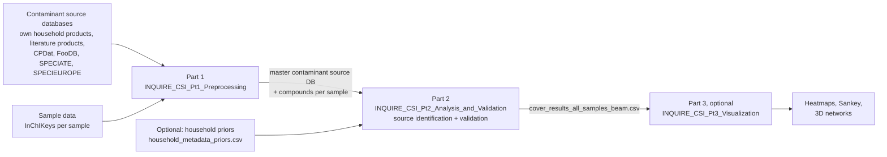

# INQUIRE_CSI – Contaminant Source Identification Pipeline

INQUIRE_CSI is a Python/JupyterLab pipeline that links organic compounds detected in environmental samples by non-target screening (compounds identified by InChIKey) to their most plausible **sources**: consumer products, building materials, food, combustion, and outdoor emission sources.

It combines a master contaminant source database (MCSDB), built from six source databases, with a **weighted set-cover** optimization. For every sample it searches for the smallest, most plausible set of sources that together explain all compounds of the sample for which at least one source is known. Two kinds of prior knowledge (priors) can make some sources more plausible than others: information about the household (e.g., wood burning, smoking, traffic, agriculture around the home), and the household's own analyzed products.

INQUIRE_CSI was developed within the INQUIRE project and first applied to ca. 200 household dust samples from 8 European countries. It can be applied to other environmental matrices whose compounds are identified by InChIKey, such as indoor air. The category priors, the links between household information and source categories, and the penalty weight (alpha) were designed and tuned for indoor dust. For other matrices they should be reviewed and alpha re-tuned (see [docs/method_and_limitations.md](docs/method_and_limitations.md)).

> **Important:** the results are an *attribution of compounds to plausible source categories*, not a quantitative source apportionment. Many compounds in a sample (about half in the INQUIRE dust data) have no source in the database; all shares refer to attributable compounds only.

**Authors:** Rebryk, Andriy¹, Molenaar, Douwe¹ – ¹Vrije Universiteit Amsterdam
**Contact:** `andrew.rebryk@gmail.com`; questions and bug reports via GitHub *Issues*.

---

## Pipeline overview



| Part | Notebook | What it does | Typical runtime* |
|---|---|---|---|
| 1 | `INQUIRE_CSI_Pt1_Preprocessing.ipynb` | Cleans and harmonizes the sample data and all source databases into one master contaminant source database (MCSDB); adds reporting classes; merges duplicate sources; keeps only compounds found in the samples | 00:13:39 |
| 2 | `INQUIRE_CSI_Pt2_Analysis_and_Validation.ipynb` – Contaminant Source Analysis and Validation | Source identification per sample (greedy + beam search set cover with priors) and a full validation suite | 05:02:00 |
| 3 | `INQUIRE_CSI_Pt3_Visualization.ipynb` (optional) | Figures of the best cover per sample: sample-group × source-category heatmaps (sample group = first two letters of the sample ID, e.g., country), Sankey diagram, interactive 3D networks | 00:12:13 |

\*Reference run (~193 samples) on a Microsoft Surface Laptop 5 (Intel Core i7-1265U, 16 GB RAM, Windows 11), Python 3.11.14; total Parts 1–3: 05:27:52. See [docs/installation.md](docs/installation.md).

---

## Repository structure

```
INQUIRE_CSI/
├── README.md                   this file
├── requirements.txt            exact package versions (pip)
├── environment.yml             same environment for Anaconda (conda)
├── CITATION.cff                how to cite this pipeline
├── LICENSE                     license of the code
├── notebooks/
│   ├── INQUIRE_CSI_Pt1_Preprocessing.ipynb
│   ├── INQUIRE_CSI_Pt2_Analysis_and_Validation.ipynb
│   └── INQUIRE_CSI_Pt3_Visualization.ipynb
├── example_data/               synthetic example data for testing, same structure as data/ (see example_data/README.md)
├── data/                       working folder (inputs + all outputs); see data/README.md
└── docs/
    ├── installation.md                  software, environment, folder structure, reproducibility
    ├── input_data.md                    all input files, formats and mandatory columns
    ├── household_priors.md              optional household priors: format and how they were built
    ├── 01_preprocessing.md              Part 1
    ├── 02_analysis_and_validation.md    Part 2
    ├── 03_visualization.md              Part 3
    ├── parameters.md                    all user-settable parameters in one place
    ├── codebook.md                      every output file and the meaning of every column
    └── method_and_limitations.md        model, validation, reference-run results, limitations
```

---

## Quick start

1. **Install** Anaconda and create the environment (details in [docs/installation.md](docs/installation.md)):
   ```
   conda env create -f environment.yml
   conda activate inquire_csi
   ```
2. **Get the input data:**
   - **Source databases and the source class mapping:** copy files into `data/` (mapping file into `data/lookups/`).
   - **Sample data:** use your own, or the synthetic test data from `example_data/` (see [data/README.md](data/README.md)).
   - **To test the pipeline first**, copy the content of `example_data/` into `data/` instead: it contains synthetic sample data, household priors and small example versions of all source databases and of the mapping file (see [example_data/README.md](example_data/README.md)).
3. **Start JupyterLab** from the repository folder: `jupyter lab`.
4. **Check the working-folder path** `DATA_DIR` in the first data-loading cell of each notebook. The default `../data` works if you keep the repository structure. In Part 2, set `USE_GEO_PRIORS = False` if you have no household priors file.
5. **Run the notebooks in order** 1 → 2 → 3 (Part 3 is optional), each with *Kernel → Restart Kernel and Run All Cells…*, and look at the points listed under "Checks" in each part's documentation.

---

## Key results and limitations (summary)

Values from the reference run on the INQUIRE dust data; exact numbers are in [docs/method_and_limitations.md](docs/method_and_limitations.md).

- **Coverage:** about half of the compounds per sample have no source in the database (unattributed). All percentages refer to the attributable compounds.
- **Compound-level recovery is good** (synthetic mixtures: compound F1 ≈ 0.9; leave-one-source-out reconstruction: F1 ≈ 0.8). **Source-level recovery is weak** (source F1 ≈ 0.14), because many database sources are chemically almost identical. Results are therefore interpreted at **source-category level**, not at the level of individual products.
- **Cover probabilities are not an uncertainty estimate.** They are derived from cost differences scaled by a temperature (`POSTERIOR_TEMPERATURE`, default "auto" = typical cost gap). They show how close alternative covers are to the best one, not measurement or identification uncertainty.
- **Shares per source database (origin) depend on the priors.** This dependence was not quantified for the reference run. Users can test it by changing `PRIOR_TO_PENALTY_RATIO` in Part 2.
- **Synthetic validations are best-case checks**: synthetic mixtures are built from database sources, so the true sources are always present in the database.
- **Category percentages are non-exclusive**: one compound can be explained by sources of several categories, so percentages do not sum to 100%.

---

## Data availability

| Data | Where | License |
|---|---|---|
| Pipeline code (this repository) | GitHub | MIT License |
| MCSDB (input files for Part 1 and the harmonized database) | Will be available from Zenodo after 1-year embargo | CC BY-NC 4.0 |
| Synthetic example data (`example_data/`: sample data, household priors, example source databases with 60 sources each, example mapping file) | this repository | CC BY-NC 4.0 |
| INQUIRE sample data and household metadata | not publicly available (personal data protected under the GDPR) | – |

**The MCSDB is presence/absence only** (which compounds occur in a source; no concentrations or weight fractions). It was built from:
- own analyzed household products (INQUIRE);
- consumer products from seven publications (Park et al. 2024; Yun et al. 2023; Phillips et al. 2018; Lowe et al. 2021; Stanfield et al. 2025; Sørensen et al. 2023; Wu et al. 2023);
- four public databases, cleaned and harmonized with separate, published pipelines:

| Database | Version | Cleanup pipeline |
|---|---|---|
| SPECIEUROPE | v3.0 | https://github.com/r3bryk/specieurope_v3.0_cleanup |
| SPECIATE | v5.4 | https://github.com/r3bryk/speciate_v5.4_cleanup |
| CPDat | v4.0 | https://github.com/r3bryk/cpdat_v4.0_cleanup |
| FooDB | v1.0 | https://github.com/r3bryk/foodb_v1.0_cleanup |

InChIKeys of all source compounds were retrieved with PubChem_Retriever (https://github.com/r3bryk/PubChem_Retriever; Rebryk et al. (2026), *Briefings in Bioinformatics* 27(5):bbag458). All harmonization and matching in INQUIRE_CSI is based on InChIKeys.

Because of license terms, the intermediate cleaned databases, which keep quantitative information where the original database has it, are not redistributed. Users who need concentrations or weight fractions (e.g., for clustering or multivariate analysis) can rebuild them from the official releases with the cleanup pipelines above. Details: [docs/input_data.md](docs/input_data.md).

## License

- **Code** (notebooks): **MIT License** (see [LICENSE](LICENSE)), https://opensource.org/license/mit.
- **Data** (master contaminant source database, example data): **Creative Commons Attribution-NonCommercial 4.0 International (CC BY-NC 4.0)**, https://creativecommons.org/licenses/by-nc/4.0/. The non-commercial condition is required because the database contains data derived from FooDB, whose commercial use and redistribution require explicit permission of the FooDB authors. The MIT license of the code does not change the license of the data.
- **Documentation** (README files, `docs/`): **Creative Commons Attribution 4.0 International (CC BY 4.0)**, https://creativecommons.org/licenses/by/4.0/.

Terms of the original source databases:

| Database | Link | Terms of use (as stated by the provider) | Please cite |
|---|---|---|---|
| FooDB v1.0 | https://foodb.ca | Freely available; commercial use or redistribution requires explicit permission of the authors | FooDB, version 1.0, https://foodb.ca (accessed 2026-05-29); Scalbert A, et al. (2011) Databases on food phytochemicals and their health-promoting effects. *J Agric Food Chem* 59(9):4331–4348 |
| CPDat v4.0 (US EPA) | https://www.epa.gov/chemical-research/chemical-and-products-database-cpdat | US EPA data are in the public domain unless otherwise specified | Dionisio KL, et al. (2018) *Sci Data* 5(1):180125; Handa S, et al. (2025) *Sci Data* 12:950 |
| SPECIATE v5.4 (US EPA) | https://www.epa.gov/air-emissions-modeling/speciate | US EPA data are in the public domain unless otherwise specified | SPECIATE version 5.4 (accessed 2026-03-13); Simon H, et al. (2010) *Atmos Pollut Res* 1(4):196–206 |
| SPECIEUROPE v3.0 (EC JRC) | https://source-apportionment.jrc.ec.europa.eu/Specieurope/index.aspx | Data may be used provided the source is mentioned | Pernigotti D, Belis CA, Spanò L (2016) *Atmos Pollut Res* 7(2):307–314 |

## Citation

If you use this pipeline, please cite it as:

> Rebryk, Andriy, Molenaar, Douwe (2026). INQUIRE_CSI – Contaminant Source Identification Pipeline (version 1.0) [Software]. GitHub. [https://github.com/r3bryk/INQUIRE_CSI]

GitHub also shows a "Cite this repository" button based on [CITATION.cff](CITATION.cff).

## Funding and acknowledgments

This work was funded by the European Union under grant agreement Project No. 101057499 – INQUIRE. This work was also co-funded by UK Research and Innovation (UKRI) under the UK government’s Horizon Europe funding guarantee [grant numbers 10038689 and 10042425] and the Australian National Health and Medical Research Council (NHMRC) [NHMRC; 2022/GNT2017837].
